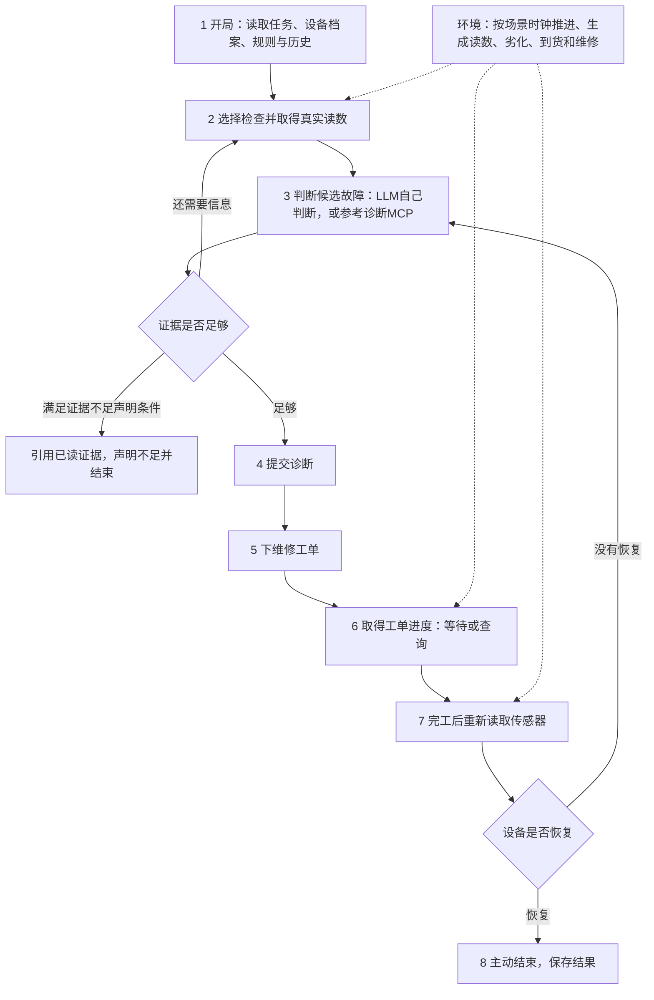

# 正常流程，以及问题发生在哪里

这是调试地图：先说明一个回合应该如何运行，再把问题放到对应步骤。修复状态指明确的代码改动及覆盖它的离线检查，不代表所有场景都已成功。

## 一个正常回合

设备健康时应诊断全健康、不下维修单并结束。当前协议只允许一次最终诊断或声明；后续重新分析用于调整维修计划，不是再次提交最终诊断。

环境负责真实状态，agent只能通过工具取得被公开的信息。工单创建不等于维修完成，工单关闭也不一定意味着维修有效：维修依赖不满足时要按环境规则处理，修后再读数确认。

不同场景的时间规则不同：Scenario1/2用于固定故障诊断，思考不推进时钟、自然劣化关闭；Scenario3/5/6开启思考计时和劣化。开启思考计时的场景按资产文件的think_seconds_per_cycle把思考秒数折算成cycle。必须同时看场景配置，不能期待每个场景都自行变坏。

## 模型的回复是怎么执行的

模型可能一次写出`读取 → 诊断 → 下单 → 等待 → 复查 → 结束`。

1. 解析器先把整份回复读成合法的动作和参数。比如传感器组必须是字符串`"tier3"`，不能给一个通道名称数组。
2. v4控制器检查下一步是否能执行，再发给MCP工具。剩余步骤保留；新观测、时间变化或预期不符时，让模型重新规划。
3. 环境执行工具，返回读数、工单状态或拒绝原因，并按规则更新设备与账本。
4. agent根据这些反馈决定下一步。

“整份计划检查”的旧问题是：后面的finish早于完工，程序就拒绝整个计划，连前面合理的读取也不做。v4改了执行检查，但**整份回复仍需能被解析**；尾部动作名或参数格式错，仍可能导致整份回复解析失败。这两类问题必须分开。

## 已修复的位置

| 问题 | 在流程哪一步 | 已做的修改 | 离线检查与范围 |
|---|---|---|---|
| 开局顺序：先读设备档案再调查 | 1→2 | 提示先读profile，再读故障模式、历史和必要时间信息 | 只改提示，没有离线检查；模型是否照做要看运行记录 |
| 无profile、无wait时开局程序异常 | 1 | profile尚未存在时，不访问其中的时长字段 | `test_no_profile_no_wait_opening_does_not_crash`覆盖无profile时有无wait、读数是否耗时的四种组合 |
| 后面的执行条件错误挡住前面的合理动作 | 2→8 | v4按下一步检查 | `test_opening_valid_prefix_survives_invalid_tail`、`test_controller_uses_checked_prefix_and_records_discarded_tail`；只覆盖执行检查，不覆盖格式错误 |
| 执行第一步后把后面都丢掉 | 各步骤之间 | v4保留未执行步骤，执行前重新检查；新情况出现则重新规划 | `test_pending_model_action_executes_without_another_model_call`；原始计划与执行记录保留 |
| 看不清有没有新数据 | 2 | 显示未读历史周期数和上次返回行数；额外拦截已知无效静态空读 | `test_empty_static_window_is_explained_but_forward_reads_remain_available`；只覆盖这一类静态空读 |

最后一项是**debug控制器新增约束**。原环境允许查询并返回零行。它没有改变设备规则，但改变了agent行为边界，必须单独标注，不能当作环境原本禁止的操作。

## 需要分开归因的问题类别

| 分类 | 在流程哪一步 | 定义 | 归因时注意 |
|---|---|---|---|
| A 模型输出不符合接口 | 2/3 | 回复不符合计划schema的情形，例如sensor_group给成通道数组、steps列表无效 | 原始回复与提示/schema不匹配，未进入实际诊断；不能直接说它诊断能力差 |
| B 重复或付不起的动作 | 4/5/7 | 诊断已提交后的再次提交；工单未完成时的重复下单；价格超过余额的读数计划 | 控制器拒绝并把原因传回模型；每条拒绝按实际原因记录，再看模型是否利用反馈 |
| C 没有数据却一直查询 | 2 | 对超出recorded_until的窗口的重复请求：这类请求返回零行，时钟不前进 | 先区分查询与时钟语义的使用问题；不能直接归为数据集不足 |
| D 环境更新与agent记录不一致 | 6→7 | 环境事件与agent的board对同一工单的状态不一致的情形 | 需要核对更新何时经工具返回；不能把agent没看到更新说成环境没演化 |
| E 检查太多、维修太晚 | 2→5 | 开启思考计时与劣化的场景中，诊断和下单晚于劣化、预算不足以完成维修的情形 | 决策、读数成本与思考时间共同影响，要分开看 |
| F 已核验恢复却不结束 | 7→8 | 维修已核验恢复后不finish、回合以max_steps结束的情形 | pass=True不代表行动效率或正常结束流程都已合格 |
| G 对照不只差诊断信息 | 三组比较 | 原无MCP工具契约还拿掉了等待等工具 | 对照存在混杂；本目录不暗改，后续需要单独的同工具能力消融 |

## 三种检查不能混为一谈

| 层 | 例子 | 是否已经操作设备 |
|---|---|---|
| 解析器 | `sensor_group`应为字符串，却收到数组 | 没有 |
| agent控制器 | 重复诊断、重复工单、超预算、过早finish、debug空读检查 | 被拦住的动作没有发出；原因传回模型 |
| 环境规则 | 工单被接收，但维修依赖不满足而不生效；时间前进后劣化或完工 | 按规则执行与更新，必须看真实结果 |

应隐藏设备故障真相，不应隐藏公开的接口要求或操作反馈。工单已接收、尚未完工、查询返回零行、参数错误都应给agent可理解的反馈。

## 整轮与后续修复

整轮运行期间v4代码冻结，全部回合完成后归档并停止GPU。后续修复方案以跨场景的运行记录为依据，不通过修改环境真相、维修标准或评分来制造成功。

## 下一版准备：尚未验证模型效果

[v005](versions/v005/README.md)用明确的字段类型和实际组名说明输出格式；展示已有核验与预算；从v004已检查的公开条件说明哪些下一步能做；逐轮写出模型原文、拒绝原因与执行反馈。离线检查见`versions/v005/source/test_protocol.py`。

这些不是已证明修好的模型行为。原parser仍拒绝错误参数；动作仍由模型选择；不会自动诊断、维修或finish。v004执行代码逐字保留，v4整轮不切换版本；v005的定向回合见[rounds/v5_targeted](rounds/v5_targeted/README.md)。
