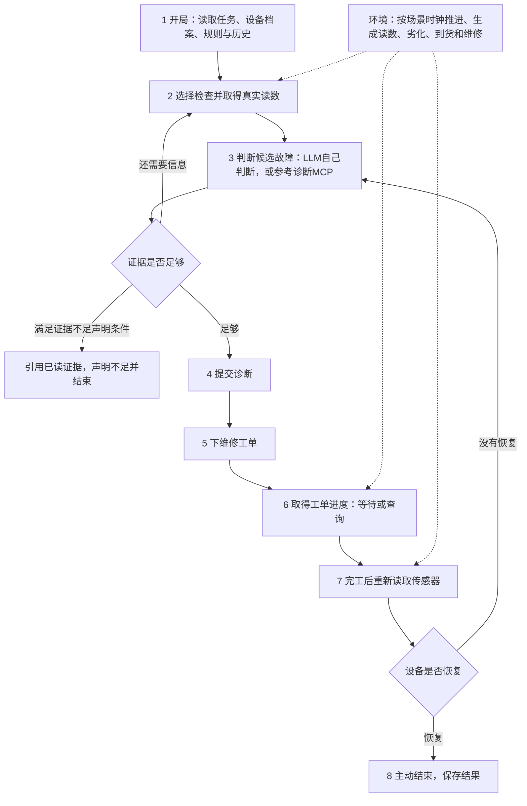

# 正常流程，以及问题发生在哪里

这是调试地图：先说明一个回合应该如何运行，再把问题放到对应步骤。修复状态指明确的代码改动和证据，不代表所有场景都已成功。

## 一个正常回合

设备健康时应诊断全健康、不下维修单并结束。当前协议只允许一次最终诊断或声明；后续重新分析用于调整维修计划，不是再次提交最终诊断。

环境负责真实状态，agent只能通过工具取得被公开的信息。工单创建不等于维修完成，工单关闭也不一定意味着维修有效：维修依赖不满足时要按环境规则处理，修后再读数确认。

不同场景的时间规则不同：Scenario1/2用于固定故障诊断，思考不推进时钟、自然劣化关闭；Scenario3/5/6开启思考计时和劣化。动态预试确认每10秒思考折算1cycle。必须同时看场景配置，不能期待每个场景都自行变坏。

## 模型的回复是怎么执行的

模型可能一次写出`读取 → 诊断 → 下单 → 等待 → 复查 → 结束`。

1. 解析器先把整份回复读成合法的动作和参数。比如传感器组必须是字符串`"tier3"`，不能给一个通道名称数组。
2. v4控制器检查下一步是否能执行，再发给MCP工具。剩余步骤保留；新观测、时间变化或预期不符时，让模型重新规划。
3. 环境执行工具，返回读数、工单状态或拒绝原因，并按规则更新设备与账本。
4. agent根据这些反馈决定下一步。

“整份计划检查”的旧问题是：后面的finish早于完工，程序就拒绝整个计划，连前面合理的读取也不做。v4改了执行检查，但**整份回复仍需能被解析**；尾部动作名或参数格式错，仍可能导致整份回复解析失败。这两类问题必须分开。

## 已修复的位置

| 问题 | 在流程哪一步 | 已做的修改 | 证据与范围 |
|---|---|---|---|
| 没读设备档案就开始调查 | 1→2 | 提示先读profile，再读故障模式、历史和必要时间信息 | 已实际取得档案与传感器读数；仍偶有模型写错动作名 |
| 无MCP开局程序崩溃 | 1 | profile尚未存在时，不访问其中的时长字段 | 11项协议检查通过；本轮无MCP实际调用模型48次并读到数据，开局异常不再出现 |
| 后面的执行条件错误挡住前面的合理动作 | 2→8 | v4按下一步检查 | 已实际推进到诊断、工单和维修后核验；不是说所有格式错误都已消失 |
| 执行第一步后把后面都丢掉 | 各步骤之间 | v4保留未执行步骤，执行前重新检查；新情况出现则重新规划 | pending步骤回归检查通过；原始计划与执行记录保留 |
| 看不清有没有新数据 | 2 | 显示未读历史周期数和上次返回行数；额外拦截已知无效静态空读 | 本轮Scenario1两种自有agent均无实际空读；不等于模型不会再提出无效请求 |

最后一项是**debug控制器新增约束**。原环境允许查询并返回零行。它没有改变设备规则，但改变了agent行为边界，必须单独标注，不能当作环境原本禁止的操作。

## 仍有问题的位置

| 分类 | 在流程哪一步 | 具体发生了什么 | 当前判断 |
|---|---|---|---|
| A 模型输出不符合接口 | 2/3 | 无MCP回合18次把通道数组放进sensor_group，21次缺少有效steps列表 | 原始回复与提示/schema不匹配，未进入实际诊断；不能直接说它诊断能力差 |
| B 重复或付不起的动作 | 4/5/7 | 已提交诊断后再次提交；有未完成工单还想重复下单；读数计划价格超过余额 | 控制器能解释拒绝，但模型没有稳定利用反馈；每条拒绝按实际原因记录 |
| C 没有数据却一直查询 | 2 | v3读完5条历史后反复请求未来窗口，51次返回零行，时间仍是0 | 查询与时钟语义没有被正确利用；不能直接归为数据集不足 |
| D 环境更新与agent记录不一致 | 6→7 | 动态预试中工单cycle52已关闭，agent最后board仍显示open | 需要核对更新何时经工具返回；不能把agent没看到更新说成环境没演化 |
| E 检查太多、维修太晚 | 2→5 | 动态预试cycle45才诊断，48才下冷却器单；阀泵未修，余额45，后续提议价格330 | 决策、读数成本与思考时间共同影响；环境已正常推进，未证明需要更大LLM |
| F 已核验恢复却不结束 | 7→8 | 本轮Scenario1+MCP已核验恢复，却继续等待，最终max_steps结束 | 停止决策仍不稳定；pass=True不代表行动效率或正常结束流程都已合格 |
| G 对照不只差诊断信息 | 三组比较 | 原无MCP工具契约还拿掉了等待等工具 | 对照存在混杂；本轮不暗改，后续需要单独的同工具能力消融 |

## 三种检查不能混为一谈

| 层 | 例子 | 是否已经操作设备 |
|---|---|---|
| 解析器 | `sensor_group`应为字符串，却收到数组 | 没有 |
| agent控制器 | 重复诊断、重复工单、超预算、过早finish、debug空读检查 | 被拦住的动作没有发出；原因传回模型 |
| 环境规则 | 工单被接收，但维修依赖不满足而不生效；时间前进后劣化或完工 | 按规则执行与更新，必须看真实结果 |

应隐藏设备故障真相，不应隐藏公开的接口要求或操作反馈。工单已接收、尚未完工、查询返回零行、参数错误都应给agent可理解的反馈。

## 当前证据：先看同一场景的三组

[第一场景三组完整记录](rounds/v4_24_20261120/REVIEW_SNAPSHOT.md)显示：

- v4+MCP：诊断正确、设备恢复，做过一次维修后MCP核验，pass=True；但最终因max_steps结束，停止决策仍有问题。
- v4无MCP：开局与读数已工作，但大量格式错误，最终到1800秒回合时限。不能用这个结果直接判断它推断故障的准确性。
- PE+MCP：使用了不对应本任务的站点/证据，工单两次返回unknown component，未恢复；有MCP可用不代表有效取到了本设备证据。

这只是3/24完成时的审阅快照。其余场景需要继续验证动态变化、维修依赖、失效截止、证据不足与健康对照，不能把一个场景的差异写成整体排名。

本轮保持v4代码冻结，24回合完成后归档并停止GPU。后续修复方案以跨场景结果为依据，不通过修改环境真相、维修标准或评分来制造成功。
