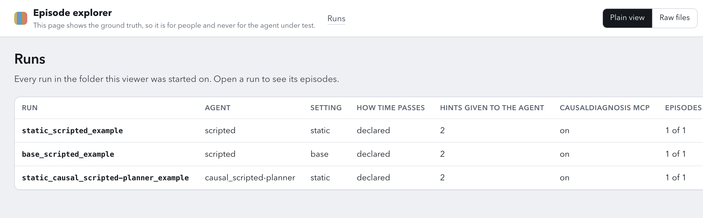
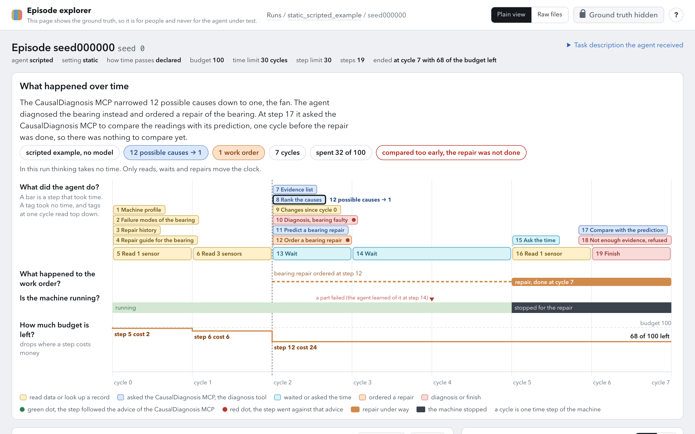
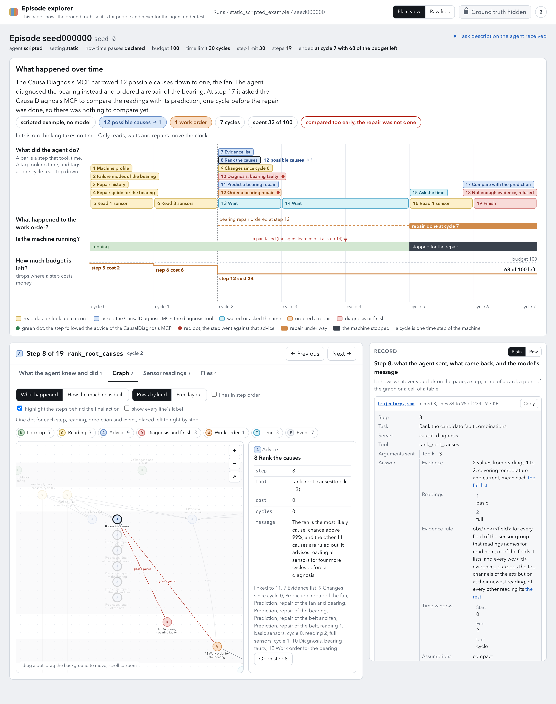
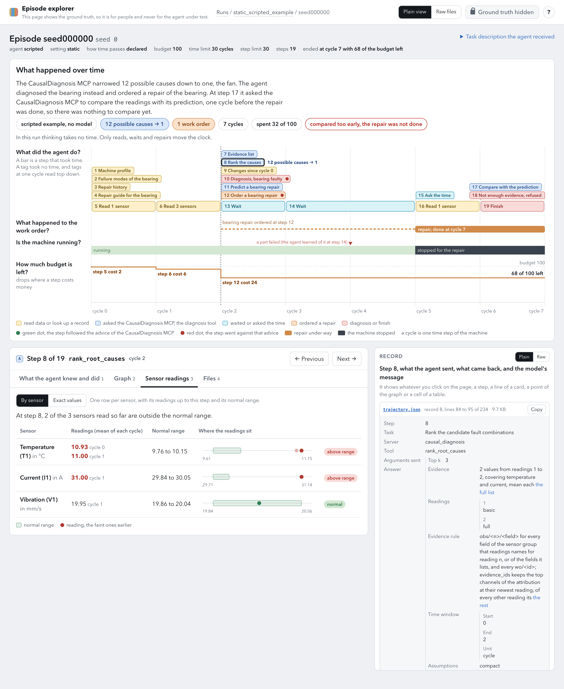
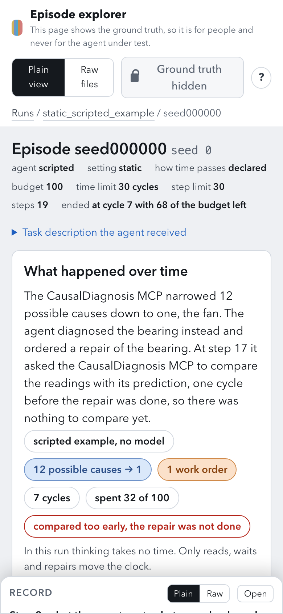

# The episode explorer

The episode explorer shows the run folders on one machine as pages in a browser. The explorer runs on `127.0.0.1` only, needs no account and no network, and reads the run folders without writing into them. Each page is for people and is never handed to an agent.

## Quick start

From the fork root, after steps 0, 1 and 2 of the quick start in [CausalDiagnosis/README.md](../README.md), which build the slim environment, fetch the data file and play one scripted episode, one command starts the explorer.

```bash
PATH=$PWD/.venv/bin:$PATH python -m CausalDiagnosis episode_viewer explorer serve --runs CausalDiagnosis/results/runs
```

The command prints the address, `http://127.0.0.1:8765/`, and serves until it is stopped with Ctrl-C. `--port` picks another port. `python -m CausalDiagnosis episode_viewer explorer export <episode folder> --out <file>.html` writes the page of one episode as one HTML file with its style, script and data inline. The command refuses an output inside the fork and inside the run folder, whose files the run ledger hashes.

## What each screen shows

The run list names every run folder under `--runs` with its agent, its setting, how time passes, the hints given to the agent, whether the CausalDiagnosis MCP was on, and how many episodes were played. The `?` button at the top of every page lists the keys and ties each plain word of the pages to the term of the paper. A possible cause is a candidate root cause, a part is a component, the machine is the asset, and the ground truth is the hidden state.



The episode page opens with one sentence on what happened and a row of labels. The sentence says how far the CausalDiagnosis MCP narrowed the possible causes and which one it put first, what the agent diagnosed and whether that went against the advice, which repair it ordered, whether and when it asked the CausalDiagnosis MCP to compare the readings after the repair with its prediction, and whether the episode ended at a limit. The first label names who played the run, a model agent with its model, or a scripted example or a fixed policy without a model. The other labels give the possible causes at the start and at the last ranking, the work orders, the cycles, the spending against the budget, the result of that comparison and a limit that ended the episode. A line under the labels says what moves the clock in the run, for instance that thinking takes no time and only reads, waits and repairs do. Below them one axis of cycles carries four rows. The first draws every step. A step that takes cycles is a bar over them, and a step that takes none is a tag at its cycle, with the tags of one cycle in step order from the top. A green dot on a tag means the step followed the advice of the CausalDiagnosis MCP, and a red dot means it went against it. The second row follows each work order from its opening through the wait for the spare part to the repair, the third shows whether the machine ran or was stopped, and the fourth shows the budget left after each step that cost money. The comparison reports whether the readings after the repair matched the state the CausalDiagnosis MCP predicted, and that state can still hold a fault, so a match does not by itself mean the machine works again. The comparison is the agent's own request and is not the verifier, which scores the episode from the hidden state. Below a window of about 1100 px the overview narrows its cycles and shortens the words of its tags, so it fits a window of 960 px without scrolling sideways. A turn of the agent that called no tool of the machine still takes one step. Such a turn is a grey dashed tag, "no tool", after the step it follows, a label counts such turns, and a click on the tag opens its line. On a run whose clock charges thinking, by its wall-clock seconds or by the tokens the model generates, a label gives the thinking the clock counted, and the card of each step gives the thinking before it. A click on the label opens one sentence on what the clock counted and what it did not. The wall clock leaves out the seconds of server starts, tool service and failed model requests. The token clock counts the tokens the model generated up to the last step, which the card of each step names, and no wall-clock time. When the harness cut an episode at its wall-clock limit, the sentence ends with the cycle of the cut and whether the agent's time ran out or the service did not answer. The run page holds a folded block on how the run was served, with the emptying of the model's cache, the check of the model at a cut and the time the episode ended.



Selecting a step moves the marker on the axis and fills the tabs below it. The Timeline tab draws the episode again in four bands on one axis, of cycles, or of steps where no call but a wait takes a cycle. The bands are the possible causes still left at each ranking, the steps in one lane per kind with the work orders in their own lane, whether the machine ran, and the spending against the budget, by kind on an axis of cycles, or the steps taken on a run without a budget. The figure view prints the Timeline tab with the sentence and labels above it at a width for a page, under a line that names who played the episode and, for a run without a model, says that the example is made up. The tab What the agent knew and did shows what the agent knew, the advice at that step, what it did and what came back. Where the advice is a ranking, a line under the possible causes it lists counts the causes with a chance that it left out, and a click on the line shows their summed chance. Where a tool answers at a level of `response_format`, as every tool of the CausalDiagnosis MCP and the profile of the task server on AssetOpsBench's rows do, the card of what came back names the level, `headline`, `concise`, `detailed` or `raw`, and says when it was the default. The card shows the answer the agent received at that level, a field that the level leaves out is marked as left out of that answer, and the count of the possible causes that a ranking at a shorter level does not repeat is the count of the level combinations, which the CausalDiagnosis MCP ranks. Every answer of the CausalDiagnosis MCP opens at each of the four levels, the one the agent received marked as seen and shown as it received it. The page writes the others from the raw answer, which the CausalDiagnosis MCP keeps beside every call that it answered at a shorter level (`raw_answers.jsonl.gz`), with the level code of the server, `answer_levels.at_level`, and the record panel says so. A run folder without that record shows the level the agent received alone. With `--hidden` the explorer recomputes the raw answers of such a run by serving every call of the CausalDiagnosis MCP again over the released evidence as it stood at the call, with the fits that leave out the hidden start, and keeps a recomputed answer only where it gives back the text that the agent received. A profile read at a shorter level writes the tool table and the normal ranges as long tables, and the card opens its raw form, one entry per field and per tool, rebuilt from the answer by `raw_of` of `CausalDiagnosis/mcp_servers/utils/profile_levels.py`. On an episode of the CausalDiagnosis agent, the card of what the agent knew opens the board that the model read in the planning request of the plan behind the step, from `llm_calls.json`, in its sections. The first and the last section stay open and every other is folded under its heading, every table shows as a table, and a value that ends in low or high, outside its normal range, is marked. The Graph tab draws the steps, the readings, the predictions and the events of the episode, or how the machine is built, as a graph whose points open their records. The Sensor readings tab puts each sensor's readings against its normal range, and the Files tab browses the files of the episode and its run that the agent could see, with machine paths shortened, in a plain form or raw.





At a phone width the page stacks into one column, and the record opens from a sheet at the bottom of the screen.



The screenshots show a scripted episode of `bench_1`, a made-up asset of the tests, and are no experimental result.

## The ground truth

The ground truth is the hidden state of an episode, the real fault, the score and the losses the agent never sees. Without `--hidden` the server sends only the files an agent could see, the `run.json` and `summary.md` of each run, and the public columns of the scores and the ledger. No file under `hidden/` is sent then, and the toggle at the top remains locked. A launcher of a server and a lock file are never read, with or without `--hidden`. With `--hidden` it also sends the hidden files of each episode, the whole ledger and every score column, so that a person can compare the run with the true state. The toggle is still off when a page opens. The true state, the verdict and the losses are drawn only while it is on. Start the explorer with `--hidden` only on your own machine.

## Tests

`CausalDiagnosis/episode_viewer/tests/test_explorer.py` plays scripted episodes of the made-up ports and of the rig into a temporary folder, one of them on AssetOpsBench's servers, and one episode of the CausalDiagnosis agent with a planner without a model. The test checks that the public pages hold no hidden value and that the browser draws no hidden mark until the toggle is on. Launchers, lock files, the private launch file of an episode, the job file of a run and paths outside the runs folder must be refused, the marks of followed advice must equal the measures of `CausalDiagnosis/evaluation/metrics/mcp_metrics.py`, the frontend must name no asset, and no file of a run folder may change. The level of every answer must be the level its call named, every answer of the CausalDiagnosis MCP must stand at the four levels, a run without raw answers must recompute them with `--hidden` alone, a profile at a shorter level must carry the raw form that `raw_of` rebuilds, every board must give back its planning request line by line, and the page must name the level of every answer, open each of its four levels, say on a run without raw answers why it shows one level and open the recomputed levels only with the ground truth shown, and open the board of every step of the CausalDiagnosis agent. The browser test needs `playwright` in the interpreter or in the one that `EXPLORER_BROWSER_PYTHON` names, and is skipped without it.
